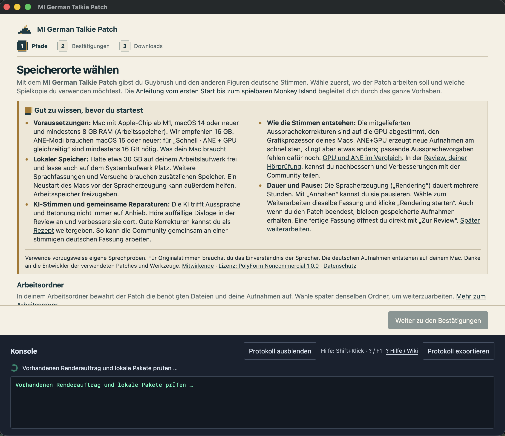
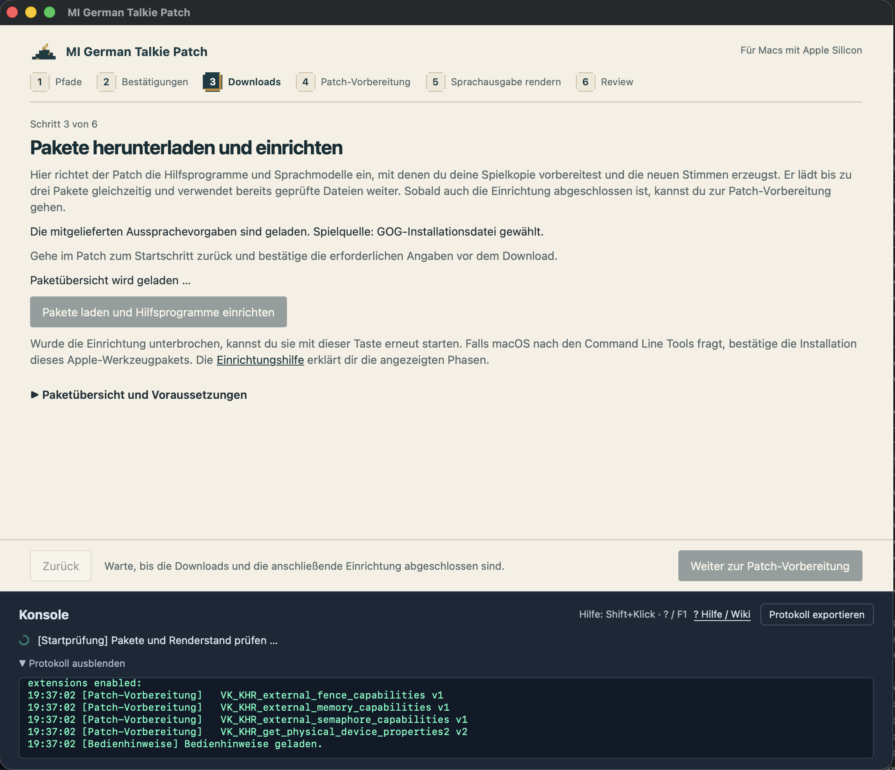
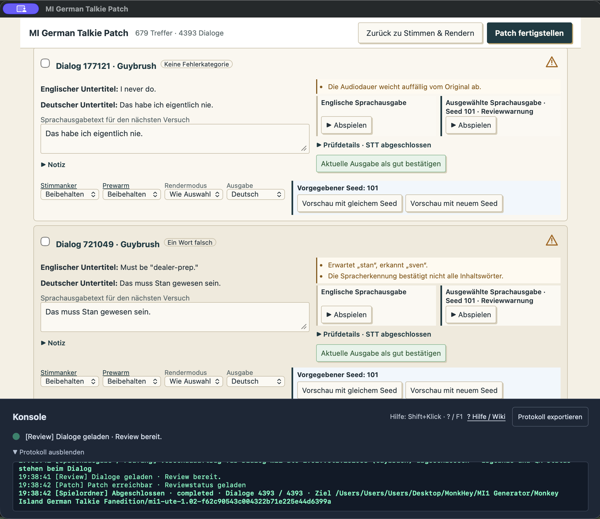
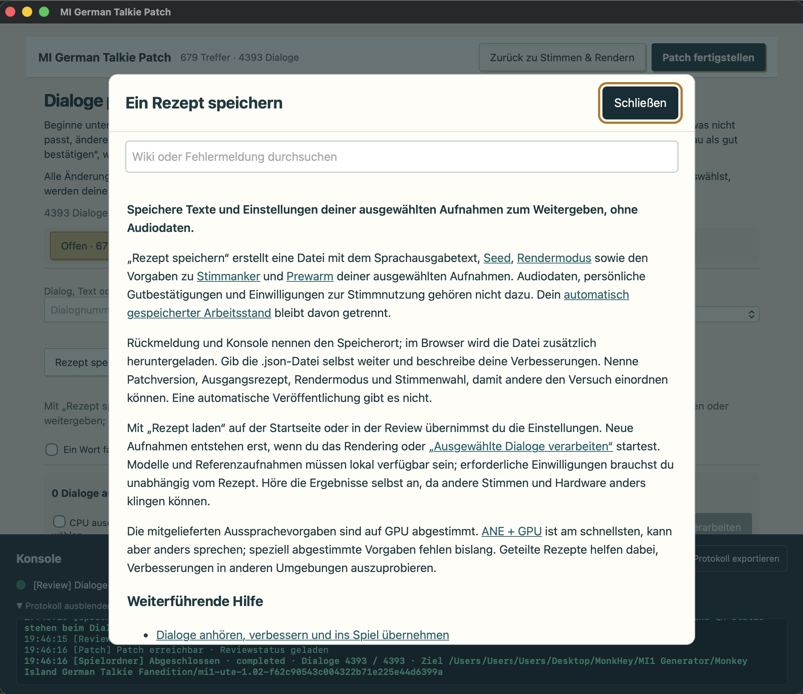
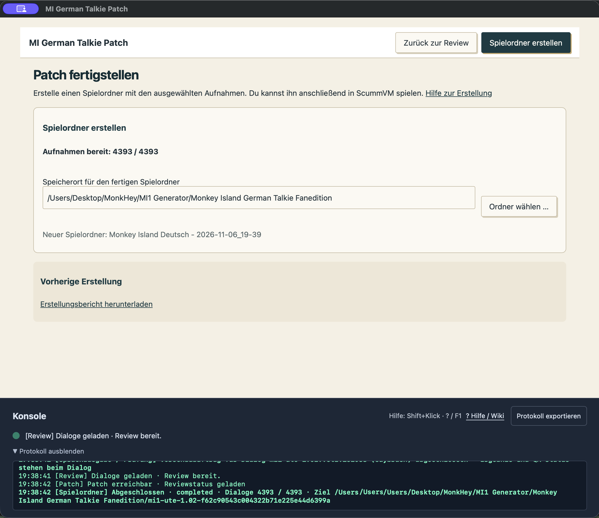

# The Secret of Monkey Island German Talkie Fanedition Patch

Guybrush Threepwood will Pirat werden. Jetzt kann er das auch jedem auf Deutsch erzählen, der seinem Plappern lange genug zuhört.

Der **The Secret of Monkey Island German Talkie Fanedition Patch** ist ein Fanprojekt für *The Secret of Monkey Island*. Aus der Monkey Island Secial Edtion bereitet er die deutsche Ultimate Talkie Edition vor und erzeugt mit KI eine deutsche Sprachausgabe. Die deutsche Sprachausgabe wird auf deinem Mac generiert. Dabei kannst du Guybrush und den anderen Piraten mit deinen eigenen Stimmen sprechen lassen. Anschließend erhälst Du den fertigen Spielordner und öffnest das gepatchte Spiel in ScummVM.

Der Patch ist der erste Teil einer geplanten Vertonungssuite für mehrere Adventures, Sprachen und Betriebssysteme. **SCUMM** mit *Monkey Island* ist der Anfang.

## Download und Start

**[App für macOS mit Apple Silicon herunterladen · Version 0.26.10](https://github.com/gurtin8/The-Secret-of-Monkey-Island-German-Talkie-Fanedition-Patch/releases/download/v0.26.10/The-Secret-of-Monkey-Island-German-Talkie-Fanedition-Patch-0.26.10-macOS-AppleSilicon.zip)**

Entpacke die ZIP-Datei, ziehe die App in deinen Programme-Ordner und öffne sie. Beim ersten Start führt sie dich durch die Einrichtung.

Die App ist lokal signiert. Falls macOS den Start wegen des unbekannten Entwicklers blockiert, findest du nach dem ersten Öffnungsversuch unter „Systemeinstellungen → Datenschutz und Sicherheit“ die Taste „Dennoch öffnen“. Bestätige das Öffnen, wenn du der heruntergeladenen App vertraust. [Apples Anleitung zum Öffnen solcher Apps](https://support.apple.com/de-de/102445)

## Was ins Inventar gehört

| Gegenstand | Was du brauchst |
| --- | --- |
| Spiel | Die Windows-Ausgabe von *The Secret of Monkey Island: Special Edition*, als installierter Spielordner oder GOG-Offline-Installer. Die Steamversion sollte auch gehen, jedoch wurde bisher nicht getestet.        |
| Mac | Apple Silicon ab M1, macOS ab 14. Für die Modi mit Apples Neural Engine (ANE) brauchst du macOS ab 15. |
| Arbeitsspeicher | Mindestens **8 GB RAM**, empfohlen sind **16 GB**. Plane für den kombinierten GPU- und ANE-Modus 16 GB ein. |
| Arbeitslaufwerk | Rund **32 GB frei** für Einrichtung und erste Sprachfassung. Der Arbeitsordner muss beschreibbar sein und auf einem Dateisystem mit Hardlink-Unterstützung liegen, etwa APFS. |
| Einrichtung | Internet für die Download und viel Geduld. Auf meiner Testmaschine MBP M1 max hat die generierung auf der GPU ca. 5 Stunden gedauert.  |
| Zum Spielen | [ScummVM](https://www.scummvm.org/downloads/), separat installiert. |

Für jede weitere vollständige Sprachfassung kannst du grob **2 GB** ansetzen. Wer viele Vorhörfassungen aufhebt, braucht mehr Platz.

## Benutze Spielkopie mit Patch

1. **Bereite das Spiel vor.** Öffne den Patch, wähle deine Spielkopie und einen Arbeitsordner. Starte die Downloads und folge den Schritten zur nativen Spielvorbereitung.
2. **Besetze die Rollen.** Wähle eigene oder für die KI-Nutzung freigegebene Sprechproben. Mit „Rendering starten“ lässt du den Mac die Dialoge einsprechen. Für das ganze Spiel braucht er ein paar Stunden.
3. **Hör dir das Ergebnis an.** Wenn LeChuck eine Drohung vorträgt wie den Wetterbericht kannst du in der Review einzelne Zeilen neu sprechen lassen.
4. **Geh spielen.** Wähle „Spielordner erstellen“, füge den Ordner in ScummVM hinzu und stelle die Spielsprache auf Deutsch.

Die genauen Klicks stehen im [Handbuch](docs/wiki/pages/wiki.start.md). In der App öffnet **Umschalt+Klick** die Hilfe zu einer Schaltfläche.

### Der Patch in Bildern

Weitere Ansichten vom Download bis zum fertigen Spielordner

**Programme und Modelle laden**

**Dialoge anhören und nachbessern**

**Verbesserungen als Rezept speichern**

**Den Spielordner erstellen**

## Sag’s noch mal richtig

Das **Manifest** ist das Drehbuch für die Sprachausgabe. Es ordnet den Dialogen die Vertonungseinstellungen zu. Hast du eine Zeile verbessert, kannst du die Einstellungen mit „Rezept speichern“ festhalten und zusammen mit der Dialog-ID eine Korrektur für das gemeinsame Manifest vorschlagen. [Korrekturen melden und Rezepte teilen](docs/wiki/pages/publication.contributing.md)

Deutsch macht den Anfang. Weitere Sprachfassungen können dieselben Dialog-IDs verwenden und ihre eigenen Texte und Aussprachevorgaben ergänzen.

## Danksagung

Danke an **Marek Roth (LogicDeLuxe)** und die Mitwirkenden der [Ultimate Talkie Edition](https://www.gratissaugen.de/ultimatetalkies/monkey1.html) für den Builder, auf dem meine Spielvorbereitung aufsetzt. Danke an **gandimann (la-patches)** und alle Beteiligten am [deutschen UTE-Patch v1.01](https://www.la-patches.de/p_mi1_ute_us-de.php) für die deutsche Spielbasis, sowie an [SCUMMKit](https://github.com/jmnunezizu/scummkit) für die dokumentierten Vorarbeiten.

Danke an **Thomas Combeleran und Donovan Watteau** für [ScummTR und ScummRP](https://github.com/dwatteau/scummtr), an **tc-mb und die ggml-Autoren** für [llama.cpp-omni](https://github.com/tc-mb/llama.cpp-omni), an **OpenBMB und Mitwirkende** für [VoxCPM2](https://github.com/OpenBMB/VoxCPM), an **0seba / seba** für [VoxCPMANE](https://github.com/0seba/VoxCPMANE) und die ANE-Konvertierungen sowie an **DennisHuang648** für [VoxCPM2-GGUF](https://huggingface.co/DennisHuang648/VoxCPM2-GGUF).

Danke auch den Menschen hinter **FFmpeg, SoX, whisper.cpp, OpenAI Whisper, Wine, Wine Mono, MoltenVK, CPython, python-build-standalone, CMake, Search von driceroland, innoextract, Boost, Zstandard, XZ Utils, Core ML Tools** und den weiteren Python-Bibliotheken. Die [vollständigen Drittanbieterhinweise](THIRD_PARTY_NOTICES.md) und das [Komponentenverzeichnis mit Versionen und Quellen](docs/THIRD_PARTY_COMPONENTS.md) halten die Zuordnung fest.

Danke an das **ScummVM-Team**, das *Monkey Island* und all die anderen Adventures auf heutigen Rechnern spielbar hält. [ScummVM](https://www.scummvm.org/)

## Launcher aus dem Quellcode bauen

Die Befehle zum Bauen der App stehen in der [Anleitung zum Paketbau](docs/PUBLICATION.md#patch-paket-bauen-und-wiki-öffnen). Dort findest du auch die Voraussetzungen für den Bau.

## Zum Nachschlagen

- [Ausführliche Bedienungsanleitung](FANEDITION.md) und [Offline-Wiki](docs/wiki/site/index.html)
- [Projektlizenz PolyForm Noncommercial 1.0.0](LICENSE) und [Drittanbieterhinweise](THIRD_PARTY_NOTICES.md)
